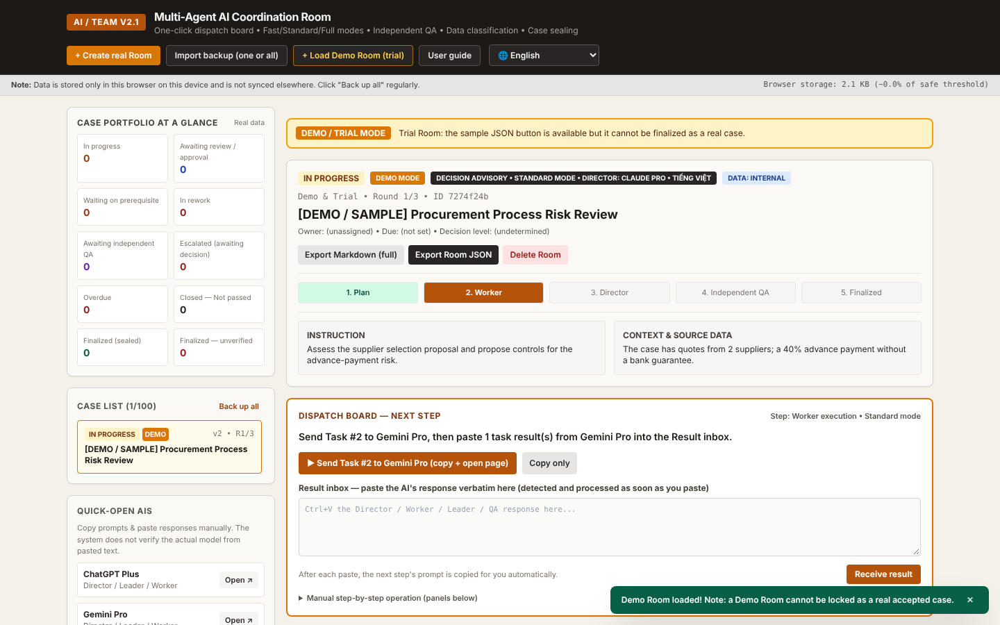

# AI Team — Multi-Agent AI Coordination Room

**Make several AI assistants work on one case together, with you approving at two gates. It runs in your browser, uses the AI subscriptions you already have, and needs no API key or server.**

👉 **Open the app:** https://ntphuong130487-wq.github.io/ai-team-app/

🌐 Available in English · Tiếng Việt · 中文 · Español · Português · Français · Deutsch · 日本語 · 한국어 · Bahasa Indonesia. Use the language picker in the top-right corner.

---

## What it does

Ask one AI for an assessment or a recommendation and you get one opinion that nobody has checked. AI Team splits the work into roles and keeps a record of every step:

| Role | Who | What it does |
|---|---|---|
| **Director** | The AI you know best (Claude, ChatGPT, Gemini, Grok, Copilot…) | Breaks the request into tasks, assigns them, reviews the results and drafts the final answer |
| **Workers** | Any AI | Each one carries out its assigned task |
| **Leader** (Full mode only) | Any AI other than the Director | Consolidates the Workers' outputs before the Director reviews them |
| **Independent QA** | Always a different AI from the Director | Checks the draft against the source material. A FAIL locks the round |
| **You** | Project owner | Approve the plan (gate 1) and finalize the case (gate 2) |

You don't type the prompts yourself. The app writes each one, copies it to your clipboard and opens the right AI. You paste the AI's answer back with Ctrl+V and the app works out which step it belongs to, then copies the next prompt.

**Output types:** decision advisory (proposals, contracts, investments) · assessment report (controls, processes, compliance) · in-depth research synthesis (multiple sources, with citations) · other.
Each type comes with its own report template. The app warns you when a section is missing.

**Processing modes:**
- **Fast**: for internal, low-risk work.
- **Standard** (the default): adds an independent QA.
- **Full**: adds a Leader layer for important or confidential cases.

## Key features

- **Zero install, zero API.** A single static HTML page. It works with the free or paid chat plans you already have.
- **Private by design.** Everything stays in your browser's localStorage, with no server and no tracking. You can export and import JSON backups.
- **Built-in guardrails:**
  - A DLP warning before sending ID numbers, account numbers, emails or "CONFIDENTIAL" marks.
  - Data classification. Confidential cases block free-tier AIs.
  - QA must come from a different AI than the Director.
- **Tamper-evident records.** Finalized cases are locked and sealed with SHA-256. A sealed case can't be edited; you create a successor case to review it again.
- **Report you can file.** Export to Markdown, or print to PDF. The report puts the conclusion first, then the evidence, then the appendices: tasks, review history and audit log.
- **Multilingual.** Choose the interface language and, separately, the output language of each case. Prompts and report headings follow the case's output language.

## Quick start (5 steps)

1. **Create a case.** Choose the Director AI, output type, mode, output language and data classification, then paste your request and source data.
2. **Approve the plan (gate 1).** Paste the prompt into the Director, copy its answer back into the *Result inbox* and approve.
3. **Follow the dispatch board.** At each step, paste the prompt into the AI shown, copy the answer and press Ctrl+V in the Result inbox.
4. **Independent QA.** Send the draft to a different AI; the app suggests one.
5. **Finalize (gate 2).** Review the decision note the Director drafted, finalize, then print the report or save it as a PDF.

A one-page guide is built into the app (**User guide** button) and can be printed in every language.

## Important: data and responsibility

- AI output is a **draft for reference**. Check figures, citations and sources before you use it.
- Follow your organization's AI and information-security policies, and your AI provider's terms. Don't paste confidential or personal data.
- Data lives only in the browser where you created it. Use **Back up all** regularly.

## Run it yourself

It is one static page. Fork the repo and turn on GitHub Pages, or serve `index.html` with the `locales/` and `assets/` folders from any static web server. Please keep the copyright notice (MIT license); copies hosted elsewhere show a small link back to the original. Automatic copy needs https or localhost.

## Contributing (translations welcome)

- **Bug reports and ideas:** open an [Issue](https://github.com/ntphuong130487-wq/ai-team-app/issues).
- **Improve a translation:** edit `locales/<lang>.js`.
  - Keys are the Vietnamese source strings and values are the translation. Keep the placeholders `{0}`, `{1}`… exactly as they are.
  - `@guide` holds the one-page guide (HTML).
  - `@h:<English heading>` keys are the report section headings. A heading that is required must stay a prefix of its longer variant, for example "Findings" → "Findings by theme".
  - Strings missing from a language fall back to English.
- **Add a language:**
  1. Copy `locales/en.js` and translate the values.
  2. Add the language code to `LANGS` in `index.html` and to the loader list in the `<head>`.
- Check coverage: `npm --prefix tools/i18n install && node tools/i18n/check.js [lang]`. It lists the strings still missing and any placeholder errors.
- Changed CSS classes in `index.html`? Rebuild the stylesheet: `npx tailwindcss@3.4.19 -c tools/css/tailwind.config.js -o assets/app.css --minify` (the app loads no scripts from CDNs).
- Run the app's built-in **Auto-Tests** before you open a pull request.

## License

[MIT](LICENSE). You can use, modify and share the app freely, including for commercial use, as long as you keep the copyright notice. The app is provided as is, without warranty.

---

## Tiếng Việt

**AI Team — Phòng Điều Phối Đa Tác Tử AI** cho nhiều AI cùng xử lý một hồ sơ, với hai cổng duyệt của người dùng.

- **Phân vai:**
  - Một AI làm **Director**: lập kế hoạch, duyệt và soạn kết quả.
  - Các AI khác làm **Worker**.
  - Một AI khác Director **thẩm định độc lập**.
- **Không cần cài đặt hay API key:** dùng tài khoản Claude/ChatGPT/Gemini… bạn đang có.
- **Dữ liệu:** chỉ lưu trên trình duyệt của bạn.
- **Ứng dụng tự soạn và copy prompt.** Bạn dán câu trả lời của AI vào *Hộp nhận kết quả*, ứng dụng tự nhận diện và chuyển bước.
- **Kiểm soát:** cảnh báo dữ liệu nhạy cảm, phân loại dữ liệu, QA độc lập bắt buộc khác Director. Hồ sơ đã chốt được niêm phong SHA-256.
- **Báo cáo:** kết luận trước, bằng chứng sau, có phụ lục và nhật ký kiểm toán. Xuất được Markdown hoặc PDF.

Mở ứng dụng: https://ntphuong130487-wq.github.io/ai-team-app/. Hướng dẫn 1 trang có trong ứng dụng (nút **Hướng dẫn sử dụng**). Kết quả AI là dự thảo tham khảo; người dùng chịu trách nhiệm kiểm tra trước khi sử dụng và tuân thủ quy định bảo mật của tổ chức.

Giấy phép: [MIT](LICENSE). Được tự do sử dụng, chỉnh sửa và chia sẻ, kể cả cho mục đích thương mại, miễn là giữ nguyên thông báo bản quyền. Ứng dụng được cung cấp nguyên trạng, không kèm bảo đảm.
